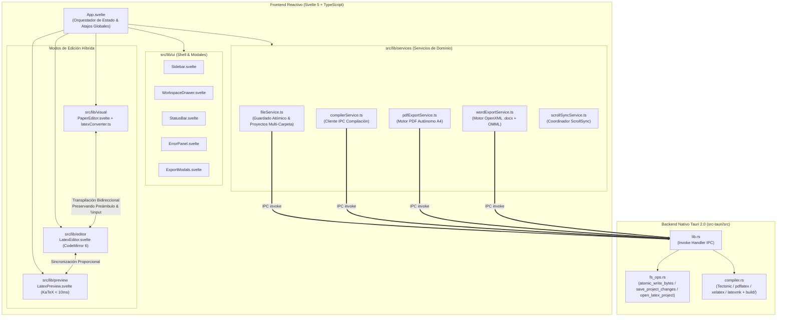
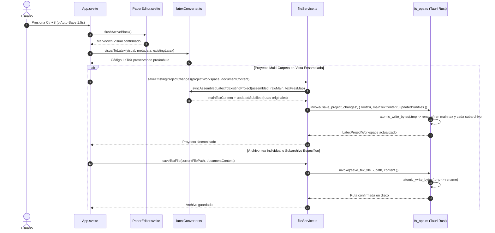

# Arquitectura Organizacional y Técnica de Layratex (v0.3.0)

Este documento describe la organización modular del código fuente, la separación de responsabilidades por capas y los flujos de datos principales de **Layratex** (Frontend Reactivo en **Svelte 5 + TypeScript** y Backend Nativo en **Tauri 2.0 + Rust**).

---

## 1. Estructura Organizacional del Repositorio

```text
layratex/
├── docs/                                # Documentación técnica, SDD, ADRs y Tickets
│   ├── ARCHITECTURE.md                  # Guía de arquitectura organizacional y módulos
│   ├── ADR/                             # Architecture Decision Records (ADR-001 a ADR-004)
│   ├── SDD/                             # Software Design Document (Módulos 01 al 08)
│   └── tickets/                         # Historial de tickets e hitos por Sprint
├── public/                              # Activos públicos estáticos
├── src/                                 # Aplicación Frontend (Svelte 5 + TypeScript + Vite)
│   ├── App.svelte                       # Orquestador de estado global y espacio de trabajo
│   ├── main.ts                          # Punto de entrada del árbol DOM
│   ├── app.css                          # Sistema de diseño editorial y variables tipográficas TeX
│   ├── assets/                          # Logotipos y fuentes Computer Modern (CMU Serif/Sans/Mono)
│   └── lib/                             # Módulos de dominio desacoplados con barriles (index.ts)
│       ├── editor/                      # Subsistema de Código Fuente LaTeX (CodeMirror 6)
│       │   ├── index.ts                 # Barril público del subsistema editor
│       │   ├── LatexEditor.svelte       # Editor CM6 con búsqueda/reemplazo y números de línea
│       │   ├── latexAutocomplete.ts     # Autocompletado contextual, entornos y snippets TeX
│       │   └── latexAutocomplete.test.ts
│       ├── preview/                     # Subsistema de Vista Previa Reactiva (< 10 ms)
│       │   ├── index.ts                 # Barril público del subsistema preview
│       │   └── LatexPreview.svelte      # Previsualizador KaTeX con estética article + visor PDF
│       ├── visual/                      # Subsistema Visual "PaperCraft" (Hoja A4 Física)
│       │   ├── index.ts                 # Barril público del subsistema visual
│       │   ├── PaperEditor.svelte       # Lienzo A4 WYSIWYM con numeración TeX y teoremas AMS
│       │   ├── latexConverter.ts        # Transpilador bidireccional LaTeX ⇄ Visual y proyectos modulares
│       │   ├── latexConverter.test.ts   # Pruebas unitarias round-trip, preámbulos y guardado quirúrgico
│       │   ├── FloatingToolbar.svelte   # Barra flotante de formato tipográfico rápido
│       │   ├── SlashMenu.svelte         # Menú rápido `/` de inserción de bloques académicos
│       │   ├── MathBuilderModal.svelte  # Constructor visual asistido de ecuaciones KaTeX
│       │   ├── TableBuilderModal.svelte # Constructor visual de tablas científicas (booktabs)
│       │   ├── KeyboardHelpModal.svelte # Guía interactiva de atajos de teclado
│       │   ├── templatePresets.ts       # Plantillas canónicas (IEEE/ACM, Álgebra, Física, Tesis)
│       │   ├── welcomeDocument.ts       # Documento académico de bienvenida
│       │   └── typography.test.ts       # Verificación de métricas tipográficas CMU
│       ├── services/                    # Capa de Servicios de Dominio e Infraestructura
│       │   ├── index.ts                 # Barril público de servicios
│       │   ├── fileService.ts           # Apertura/guardado atómico .tex, proyectos multi-carpeta y recientes
│       │   ├── compilerService.ts       # Puente IPC hacia compiladores LaTeX en Rust
│       │   ├── pdfExportService.ts      # Motor autónomo de exportación PDF multipágina A4
│       │   ├── wordExportService.ts     # Motor OpenXML (.docx) con ecuaciones nativas OMML
│       │   ├── wordExportService.test.ts
│       │   ├── latexLogParser.ts        # Analizador de logs TeX (errores, warnings, badboxes)
│       │   ├── latexLogParser.test.ts
│       │   ├── scrollSyncService.ts     # Sincronización proporcional anti-bucle (ScrollSync)
│       │   ├── scrollSyncService.test.ts
│       │   ├── preferencesService.ts    # Persistencia de preferencias de usuario y temas
│       │   └── preferencesService.test.ts
│       └── ui/                          # Componentes del Shell de Interfaz y Modales
│           ├── index.ts                 # Barril público de componentes UI
│           ├── Sidebar.svelte           # Barra lateral de navegación (Archivos, P2P, Ajustes)
│           ├── WorkspaceDrawer.svelte   # Cajón desplegable de árbol de proyecto, build/ y red P2P
│           ├── StatusBar.svelte         # Barra de estado inferior con métricas en vivo
│           ├── ErrorPanel.svelte        # Panel interactivo de diagnósticos con salto de línea
│           ├── ExportModals.svelte      # Modales de éxito de exportación (.pdf / .docx) y error
│           └── PreferencesModal.svelte  # Modal de configuración global del editor
└── src-tauri/                           # Backend Nativo Multiplataforma (Rust + Tauri 2.0)
    ├── Cargo.toml                       # Dependencias de Rust y configuración del crate
    ├── tauri.conf.json                  # Configuración de ventana, empaquetado y seguridad
    ├── capabilities/default.json        # Permisos ACL explícitos (dialog, fs)
    └── src/
        ├── main.rs                      # Punto de entrada binario del proceso nativo
        ├── lib.rs                       # Registro de comandos IPC (`#[tauri::command]`)
        ├── compiler.rs                  # Detección/ejecución de motores LaTeX + sincronización a build/
        └── fs_ops.rs                    # Operaciones I/O atómicas (.tex, .pdf, .docx, proyectos modulares)
```

---

## 2. Diagrama de Arquitectura Modular (Frontend ⇄ Backend)



---

## 3. Flujos Técnicos Clave

### 3.1 Arquitectura de Guardado en 5 Pilares (Flush-First + Quirúrgico + Escritura Atómica)

El sistema de guardado de Layratex está diseñado bajo **5 pilares de ingeniería** para garantizar cero pérdida de datos tanto en archivos `.tex` individuales como en proyectos modulares multi-carpeta (`main.tex` + `secciones/` + `figuras/` + `build/`):

1. **Pilar 1 — Confirmación Síncrona del Bloque Activo (*Flush-First Pipeline*)**:
   - Antes de cualquier operación de guardado (`Ctrl+S`), auto-guardado, cambio de pestaña (`Hoja LaTeX` ⇄ `Código .tex`) o exportación (`.pdf` / `.docx`), `App.svelte` invoca síncronamente `paperEditorRef.flushActiveBlock()`.
   - Esto garantiza que el párrafo, ecuación o tabla donde está parpadeando el cursor vuelque su estado en edición al modelo de datos antes de serializar a LaTeX.
2. **Pilar 2 — Preservación Quirúrgica de Preámbulo y Estructura Multi-Carpeta (`syncAssembledLatexToExistingProject`)**:
   - En un archivo `.tex` único: `visualToLatex(..., existingLatex)` conserva intactos todos los paquetes (`\usepackage`), macros (`\newcommand`) y configuraciones previas a `\begin{document}`.
   - En un **Proyecto Multi-Carpeta**:
     - Si el usuario edita un subarchivo específico (ej. `chapters/01_intro.tex`), se guarda únicamente ese archivo en disco.
     - Si el usuario edita el **Documento Ensamblado Completo** desde la `Hoja LaTeX`, `syncAssembledLatexToExistingProject` mapea cada sección de vuelta a su archivo `\input{...}` o `\include{...}` original respetando sus nombres de carpeta personalizados (`chapters/`, `secciones/`, `partes/`), actualiza `\title`/`\author` en `main.tex` sin tocar sus comandos de bibliografía, y si se añadieron nuevas secciones, las crea en la misma carpeta de capítulos del proyecto.
3. **Pilar 3 — Escritura Atómica en Disco (`atomic_write_bytes` en `src-tauri/src/fs_ops.rs`)**:
   - Ningún archivo `.tex`, `.bib`, `.pdf` o `.docx` se trunca directamente en su ruta final.
   - El backend en Rust escribe primero los bytes completos en un archivo temporal oculto en el mismo directorio (`.{nombre}.{epoch_ms}.layratex.tmp`) y luego ejecuta un `fs::rename` atómico del sistema operativo sobre el archivo destino. Si ocurriera un corte de energía a mitad de escritura, el archivo original permanece intacto.
4. **Pilar 4 — Auto-Guardado de Dos Niveles (*Two-Tier Auto-Save & Draft Recovery*)**:
   - **Nivel 1 (Borrador en Memoria / Sin ruta en disco)**: Mientras un documento nuevo aún no ha sido guardado con `Ctrl+S`, el auto-guardado (debounce de `1500 ms`) persiste silenciosamente el borrador en `localStorage` (`layratex_draft_title`, `layratex_draft_author`, `layratex_draft_content`) sin interrumpir al usuario con ventanas emergentes del sistema operativo, y lo recupera automáticamente al iniciar la aplicación.
   - **Nivel 2 (Archivo o Proyecto con ruta en disco)**: Una vez que existe `currentFilePath` o `projectWorkspace`, el auto-guardado sincroniza silenciosamente en segundo plano hacia el disco mediante escritura atómica.
5. **Pilar 5 — Aislamiento de Artefactos de Compilación en `build/`**:
   - Los archivos fuente del autor (`main.tex`, `secciones/*.tex`, `referencias.bib`) nunca se mezclan con archivos auxiliares de compilación.
   - Tanto el compilador nativo (`sync_compilation_artifacts_to_project_build` en `compiler.rs`) como los motores de exportación dirigen `.aux`, `.log`, `.toc`, `.out`, `.bbl`, `.pdf` y `.docx` hacia la subcarpeta `<proyecto>/build/`, la cual puede limpiarse en un clic con el botón **Limpiar `build/`**.



### 3.2 Exportación Nativa a Microsoft Word (`.docx` OpenXML + OMML)
- Implementada íntegramente en `src/lib/services/wordExportService.ts` sin dependencias pesadas externas.
- Empaqueta en memoria un archivo ZIP OpenXML estándar (`[Content_Types].xml`, `word/document.xml`, `word/styles.xml`) con tipografía **CMU Serif / Cambria Math**, márgenes académicos de 25 mm, tablas científicas estilo `booktabs` y **ecuaciones matemáticas editables nativas de Word (`<m:oMath>` / `<m:oMathPara>`)** con numeración derecha `(1)`.
