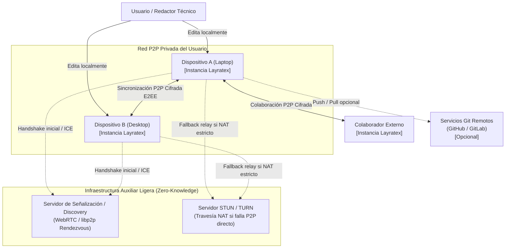
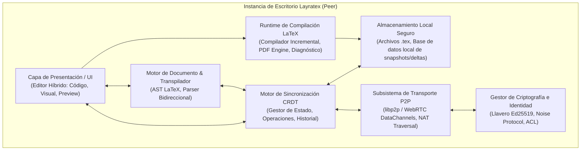
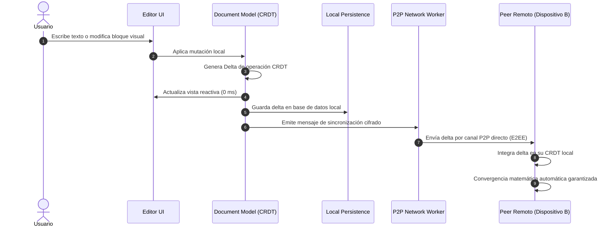

# SDD 02 — Arquitectura del Sistema (Modelo C4)

Este documento detalla las vistas arquitectónicas de Layratex utilizando el modelo **C4 (Contexto, Contenedores y Componentes)**.

---

## 2.1 Nivel 1: Diagrama de Contexto del Sistema

Describe cómo interactúa el usuario y sus dispositivos con el entorno y servicios externos.

---

## 2.2 Nivel 2: Diagrama de Contenedores

Detalla los principales subsistemas que conforman la aplicación de escritorio en cada nodo cliente.

---

## 2.3 Nivel 3: Diagrama de Componentes (Motor de Sincronización y Red)

Profundiza en la interacción entre la edición del usuario, la generación de deltas CRDT y el transporte de red.

---

## 2.4 Resumen de Responsabilidades por Contenedor

1. **Capa de Presentación (UI):** Renderiza el editor dividido (Modo Código, Modo Visual WYSIWYM y Modo Vista Previa PDF/Canvas). Despacha eventos de usuario sin esperas asíncronas.
2. **Motor de Sincronización CRDT:** Mantiene la verdad canónica del documento en memoria y disco, resolviendo divergencias sin pérdida de información.
3. **Subsistema de Transporte P2P:** Administra sockets de datos cifrados, descubrimiento de pares en LAN e Internet, y travesía de cortafuegos (NAT Traversal).
4. **Runtime de Compilación LaTeX:** Coordina la compilación local y generación rápida de vistas previas incrementales sin bloquear el hilo principal.
5. **Criptografía e Identidad:** Protege las llaves del usuario, valida firmas de mutaciones entrantes y orquesta el emparejamiento por QR.
