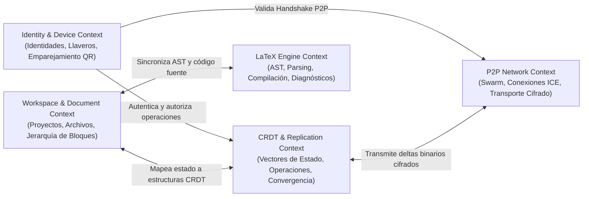

# SDD 03 — Modelo de Dominio (Domain-Driven Design - DDD)

Este documento describe el diseño estratégico y táctico del dominio de **Layratex**, estructurado según los principios de **Domain-Driven Design (DDD)**.

---

## 3.1 Diseño Estratégico: Bounded Contexts (Contextos Delimitados)

El sistema se descompone en 5 contextos delimitados claramente desacoplados:

---

## 3.2 Diseño Táctico por Contexto Delimitado

### 1. Identity & Device Context
Responsable de la identidad soberana de los nodos y la red de confianza entre dispositivos.

* **Agregado Raíz:** `DeviceIdentity`
  * **Entidad:** `Device` (ID de dispositivo, nombre legible, fecha de registro, estado de confianza).
  * **Value Objects:** 
    * `PublicKey` (Ed25519)
    * `DeviceFingerprint` (Hash SHA-256 de la clave pública)
    * `PairingCode` (Token efímero de alta entropía para emparejamiento)
  * **Servicios de Dominio:** 
    * `DevicePairingService`: Orquesta el intercambio seguro de claves vía código QR y prueba de conocimiento cero o Noise Protocol handshake.
  * **Eventos de Dominio:** 
    * `DevicePairedEvent`
    * `DeviceRevokedEvent`

---

### 2. Workspace & Document Context
Modela los proyectos LaTeX, su estructura arbórea y la representación del contenido.

* **Agregado Raíz:** `Document`
  * **Identificador:** `DocumentId` (UUID v4 / Cripto-hash del creador)
  * **Entidades:**
    * `BlockNode` (Nodo de contenido semántico: Sección, Párrafo, Tabla, Ecuación, Figura, Bloque de Código).
    * `AssetReference` (Referencia a imágenes, fuentes bibliográficas `.bib`).
  * **Value Objects:**
    * `DocumentMetadata` (Título, autor, clase de documento `article`, `report`, etc.).
    * `BlockType` (Enum: `SECTION`, `MATH_DISPLAY`, `TABLE`, `LIST`, `CODE_LISTING`, etc.).
    * `CursorPosition` (Línea, columna o ID de nodo y offset).
  * **Eventos de Dominio:**
    * `DocumentCreatedEvent`
    * `BlockContentMutatedEvent`
    * `AssetAttachedEvent`

---

### 3. CRDT & Replication Context
Asegura la replicación matemática libre de conflictos en entornos concurrentes y distribuidos.

* **Agregado Raíz:** `CRDTDocumentState`
  * **Value Objects:**
    * `OperationId` (`(PeerId, Counter)` - Tupla única determinista)
    * `HybridLogicalClock (HLC)`: Reloj lógico para ordenar eventos respetando la causalidad en redes asíncronas.
    * `StateVector`: Mapa de las últimas versiones conocidas de cada nodo del enjambre.
    * `DeltaPayload`: Fragmento binario compacto con mutaciones aplicables.
  * **Servicios de Dominio:**
    * `CRDTReconciliationService`: Integra deltas entrantes con el árbol local garantizando idempotencia, conmutatividad y asociatividad.
  * **Eventos de Dominio:**
    * `DeltaGeneratedEvent`
    * `RemoteDeltaAppliedEvent`
    * `SyncConvergedEvent`

---

### 4. LaTeX Engine Context
Maneja la transformación entre código LaTeX y representación de bloques, además de compilar documentos a PDF de forma no bloqueante.

* **Entidades y Agregados:**
  * `CompileJob`: Instancia de compilación con parámetros (`engine`: `pdflatex`, `xelatex`, `lualatex`, flags, timestamp).
* **Value Objects:**
  * `LaTeXSourceText`: Código textual estándar `.tex`.
  * `SyntaxTree (AST)`: Representación estructural en árbol.
  * `CompilerDiagnostic`: Error o warning (archivo, línea, mensaje de error detallado, snippet sugerido).
  * `RenderedArtifact`: PDF binario o mapas de página renderizados en Canvas/SVG.
* **Servicios de Dominio:**
  * `LaTeXASTParserService`: Convierte código LaTeX en árbol semántico y viceversa (Round-trip AST preservation).
  * `IncrementalPreviewRenderer`: Genera previsualizaciones ultrarrápidas de fragmentos matemáticos y texto sin requerir una compilación completa de todo el PDF.

---

### 5. P2P Network Context
Gestiona la membresía del enjambre y el intercambio de paquetes en la red.

* **Agregado Raíz:** `SwarmSession`
  * **Entidad:** `PeerConnection` (Estado de conexión: `CONNECTING`, `DIRECT_P2P`, `RELAYED`, `DISCONNECTED`).
  * **Value Objects:**
    * `Multiaddress`: Dirección de red normalizada (ej. `/ip4/192.168.1.50/tcp/4001/p2p/Qm...`).
    * `ConnectionMetrics`: Latencia (RTT), bytes transmitidos, calidad de enlace.
  * **Servicios de Dominio:**
    * `NATTraversalService`: Ejecuta STUN binding y negociación ICE para abrir canales directos.
    * `SecureChannelService`: Cifra y descifra paquetes con Noise Protocol (ChaCha20-Poly1305).
  * **Eventos de Dominio:**
    * `PeerDiscoveredEvent`
    * `DirectConnectionEstablishedEvent`
    * `PeerDisconnectedEvent`
