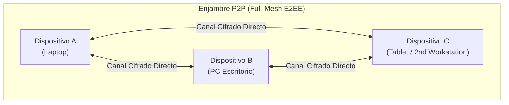
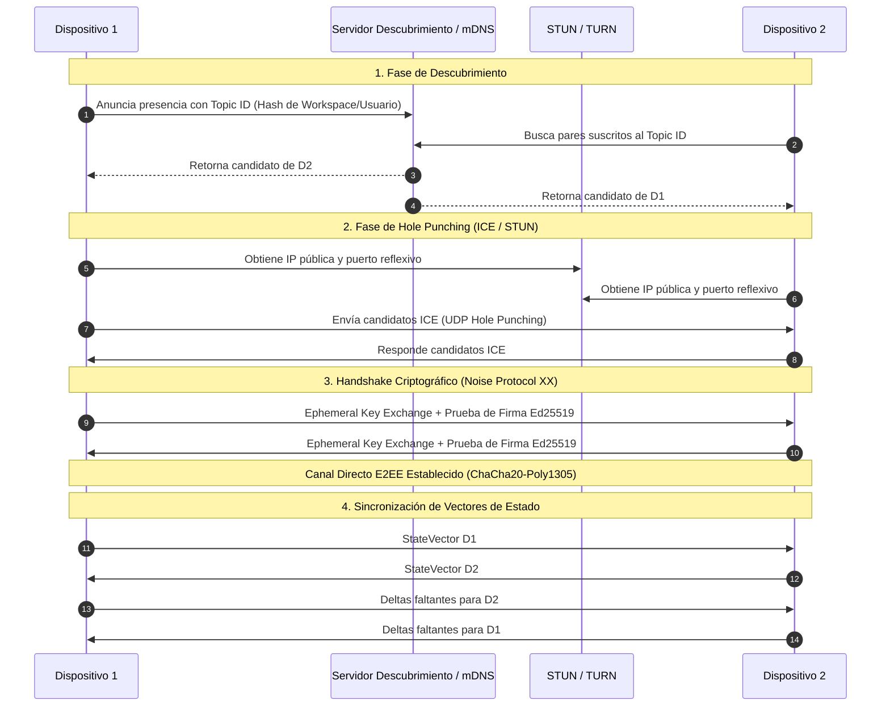

# SDD 04 — Protocolo de Red P2P y Topología

Este documento describe la arquitectura de red peer-to-peer (P2P), el protocolo de transporte, descubrimiento de nodos y superación de cortafuegos (NAT Traversal) en **Layratex**.

---

## 4.1 Topología de Red: Mesh Descentralizado

Para la sincronización entre dispositivos de un usuario y sesiones colaborativas de equipos pequeños o medianos, Layratex implementa una topología **Full-Mesh (Malla Completa)**:

Cada dispositivo emparejado establece una conexión directa bidireccional punto a punto con los demás pares activos. La pérdida de un nodo no interrumpe la sincronización entre los nodos restantes.

---

## 4.2 Fases del Ciclo de Vida de Conexión P2P

---

## 4.3 Estrategia de Descubrimiento de Nodos

### 1. En Red de Área Local (LAN)
* **Mecanismo:** mDNS (Multicast DNS) y UDP Broadcast en puerto configurable.
* **Ventaja:** Conexión ultrarrápida instantánea sin salir a Internet ni consumir ancho de banda externo cuando los dispositivos están en la misma red Wi-Fi o cableada.

### 2. A través de Internet (WAN)
* **Topic ID Seguro:** Cada espacio de trabajo o grupo de dispositivos de un usuario genera un `SwarmTopic = HMAC-SHA256(UserSecret, WorkspaceId)`.
* **Servidor de Señalización Ligero:** Los nodos publican su `SwarmTopic` en nodos de señalización (WebSocket liviano o Kademlia DHT de libp2p) únicamente para intercambiar metadatos de conexión (`SDP Offer/Answer`).
* **Privacidad Zero-Knowledge:** El servidor de señalización nunca conoce la identidad del usuario, ni el contenido del documento, ni tiene llaves de descifrado.

---

## 4.4 Travesía de NAT y Cortafuegos (Hole Punching & Relay)

1. **Conexión Directa Preferente (Interactive Connectivity Establishment - ICE):**
   * Intento 1: Conexión host directa (IP local).
   * Intento 2: Conexión mediante STUN reflexivo (UDP Hole Punching a través de routers NAT estándar).
2. **Fallback Transparente (TURN Relay):**
   * Si ambos dispositivos se encuentran detrás de NATs simétricos estrictos que impiden el UDP Hole Punching, el tráfico se redirige a través de un relay TURN.
   * **Garantía de Seguridad:** Aunque el paquete pase por el relay, la carga útil viaja cifrada con la clave de sesión acordada en el handshake Noise. El relay sólo ve bytes opacos cifrados.

---

## 4.5 Especificación del Protocolo de Mensajería P2P

Los paquetes que circulan por el canal de datos utilizan un framing binario eficiente (Header de longitud + Tipo de Mensaje + Payload comprimido):

| Código | Tipo de Mensaje | Función |
| :---: | :--- | :--- |
| `0x01` | `SYNC_STEP_1_STATE_VECTOR` | Envía el vector de estado local para que el par determine qué deltas hacen falta. |
| `0x02` | `SYNC_STEP_2_UPDATE_PAYLOAD` | Envía el paquete binario de deltas CRDT comprimidos. |
| `0x03` | `LIVE_PRESENCE_UPDATE` | Informa posición del cursor, selecciones activas y estado de foco. |
| `0x04` | `HEARTBEAT_PING_PONG` | Mensajes de liveness cada 5 segundos para monitoreo de RTT y reconexión inmediata. |
| `0x05` | `TERMINATE_SESSION` | Notificación de cierre ordenado de sesión. |
