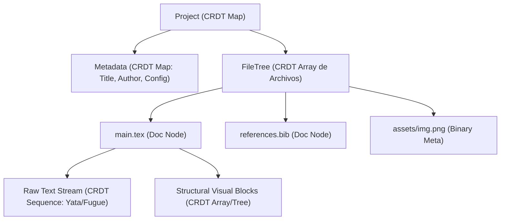
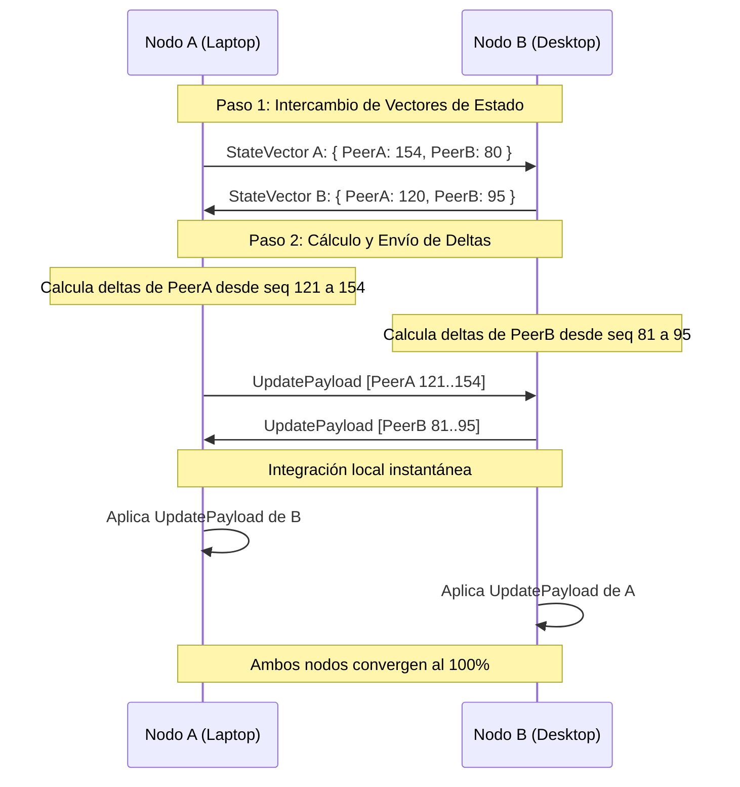

# SDD 05 — Modelo de Datos y Motor CRDT

Este documento describe la estructura matemática de datos de **Layratex**, los tipos de **CRDT (Conflict-free Replicated Data Types)** empleados y la persistencia local bajo el modelo **Local-First**.

---

## 5.1 ¿Por qué CRDT en lugar de Transformación Operacional (OT)?

Tradicionalmente, herramientas como Google Docs utilizan **OT (Operational Transformation)**, la cual exige un **servidor central autoritativo** para ordenar y transformar las operaciones. 

En Layratex, al ser una arquitectura P2P sin servidor central, se utiliza **CRDT**:
* **Conmutatividad:** El orden en que se reciben las operaciones concurrentes no altera el resultado final.
* **Idempotencia:** Si un paquete de sincronización se recibe duplicado por la red, no genera duplicidad en el documento.
* **Asociatividad:** Las operaciones pueden agruparse en deltas sin importar la segmentación de red.

---

## 5.2 Estructura Jerárquica del Documento en CRDT

Un proyecto en Layratex se modela como un árbol distribuido compuesto por dos estructuras de CRDT complementarias:

### 1. CRDT de Secuencia de Texto (Sequence CRDT)
* **Algoritmo:** Inspirado en Yata / Fugue (utilizado en librerías probadas como Yjs o Automerge).
* **Función:** Representa el código fuente LaTeX carácter por carácter o token por token.
* **Manejo de cursores:** Identificadores relativos inmutables `(PeerId, Clock)`, lo que asegura que si otro usuario borra o agrega texto antes de tu cursor, tu posición relativa en la pantalla no se desplace erróneamente.

### 2. CRDT de Estructura de Bloques (Tree / Map CRDT)
* **Función:** Modela la vista de edición visual (bloque de título, sección, tabla, bloque de ecuación).
* **Consistencia:** Si dos usuarios reordenan secciones al mismo tiempo mientras están desconectados, el algoritmo resuelve el orden de forma determinista mediante marcas de tiempo de Lamport / Hybrid Logical Clocks sin crear ciclos ni pérdida de nodos.

---

## 5.3 Protocolo de Sincronización en 2 Pasos (State Vector Sync)

Para minimizar el consumo de ancho de banda y batería, los nodos intercambian deltas calculados con precisión:

---

## 5.4 Persistencia Local y Proyección a Archivos `.tex`

Layratex adopta el principio de que los archivos del usuario deben ser legibles externamente por cualquier otra herramienta estándar:

1. **Almacenamiento del Historial CRDT:** 
   * Se guarda en un almacén embebido local ultrarrápido (SQLite con WAL mode o base de datos KV embebida) ubicado en el directorio de configuración del proyecto (`.layratex/sync.db`).
2. **Proyección Bidireccional a Disco:**
   * El estado actual del CRDT se proyecta y escribe en tiempo real como archivos de texto plano `.tex` en el sistema de archivos del usuario.
   * Si el usuario edita el `.tex` externamente (ej. con Vim o VS Code), un file-watcher local detecta el cambio, calcula el diff y genera los deltas CRDT correspondientes para propagarlos por la red P2P.
