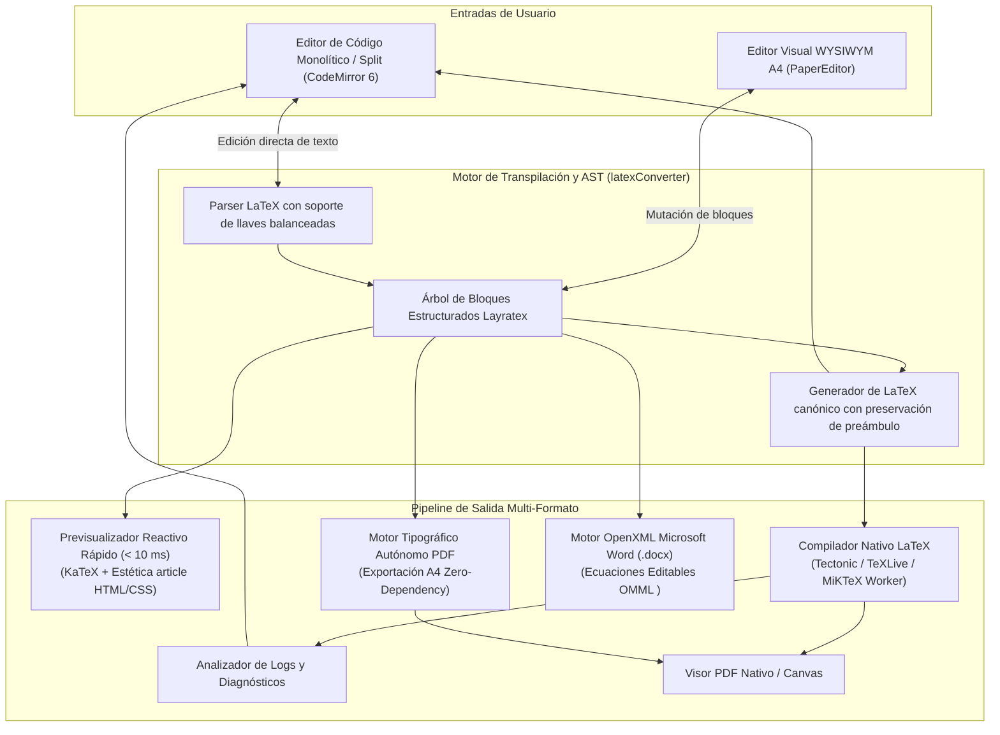

# SDD 06 — Motor de LaTeX, Pipeline, Exportación PDF/Word y Renderizado

Este documento describe la arquitectura del motor de compilación, el parsing bidireccional entre código LaTeX y componentes visuales, la exportación a PDF y Microsoft Word (`.docx` OpenXML + OMML), y el pipeline de renderizado reactivo de **Layratex**.

---

## 6.1 Arquitectura del Pipeline de Edición Híbrida

Layratex permite que el usuario alterne libremente entre el editor de código LaTeX, el editor visual estructurado por bloques sobre hoja A4 y una vista previa reactiva.

---

## 6.2 Parser Bidireccional y Preservación Round-Trip

Uno de los mayores retos en editores LaTeX visuales es no destruir el formato original, comentarios ni macros personalizadas del usuario.

### Principios del Parser Layratex (`latexConverter.ts`):
1. **Preservación de Preámbulo y Llaves Anidadas:** `extractLatexMetadata` analiza comandos `\title{...}`, `\author{...}` y `\date{...}` mediante conteo de llaves balanceadas, permitiendo comandos anidados como `\textbf{...}` o matemáticas `$...$` dentro del título. Al guardar desde el modo visual, `visualToLatex` conserva intactos los paquetes personalizados (`\usepackage{...}`) del preámbulo original.
2. **Limpieza Inteligente de Comentarios:** Los comentarios de línea `%` no escapados se filtran al proyectar la hoja visual mientras que los porcentajes literales `\%` se preservan como `%`.
3. **Entornos Académicos AMS y Tablas `booktabs`:** Reconoce y transpila bidireccionalmente `\begin{abstract}`, `\begin{theorem}`, `\begin{definition}`, `\begin{lemma}`, `\begin{proof}` y tablas científicas con `\toprule`, `\midrule` y `\bottomrule`.

---

## 6.3 Estrategia de Renderizado y Exportación en 3 Niveles

Para satisfacer el requisito de latencia inferior a 200 ms (**RNF-04**) y ofrecer interoperabilidad editorial completa, la salida se organiza en tres canales:

| Nivel | Mecanismo | Latencia | Propósito |
| :--- | :--- | :--- | :--- |
| **Nivel 1: Live Preview Incremental** | Motor reactivo local (KaTeX + numeración automática de secciones y ecuaciones estilo `article`). | **< 10 - 50 ms** | Retroalimentación instantánea mientras el usuario redacta en tiempo real. |
| **Nivel 2: Compilación PDF Dual (Nativa + Autónoma)** | Invocación asíncrona de `tectonic`/`pdflatex` en Rust con fallback automático al motor autónomo A4 (`pdfExportService`). | **0.4 - 2.5 s** | Generación de documentos PDF A4 listos para publicación e impresión. |
| **Nivel 3: Exportación Microsoft Word (`.docx` OMML)** | Generador OpenXML ZIP en memoria (`wordExportService`) con transpilador LaTeX $\rightarrow$ Office Math (`<m:oMath>`). | **< 50 ms** | Intercambio con revisores y revistas que exigen manuscritos `.docx` con fórmulas nativas editables. |

---

## 6.4 Analizador Inteligente de Diagnósticos de Compilación

La salida estándar de los compiladores LaTeX tradicionales suele ser críptica (`Transcript/Log` de miles de líneas).

Layratex integra un `LaTeXLogParser` reactivo que:
1. Detecta patrones estándar: `! LaTeX Error: <mensaje>` y `l.<línea_número> <contexto>`.
2. Clasifica eventos en Errores críticos, Advertencias (`LaTeX Warning`) y Cajas Desbordadas (`Overfull/Underfull \hbox`).
3. Permite navegar directamente a la línea afectada en el editor CodeMirror 6 con un solo clic.
