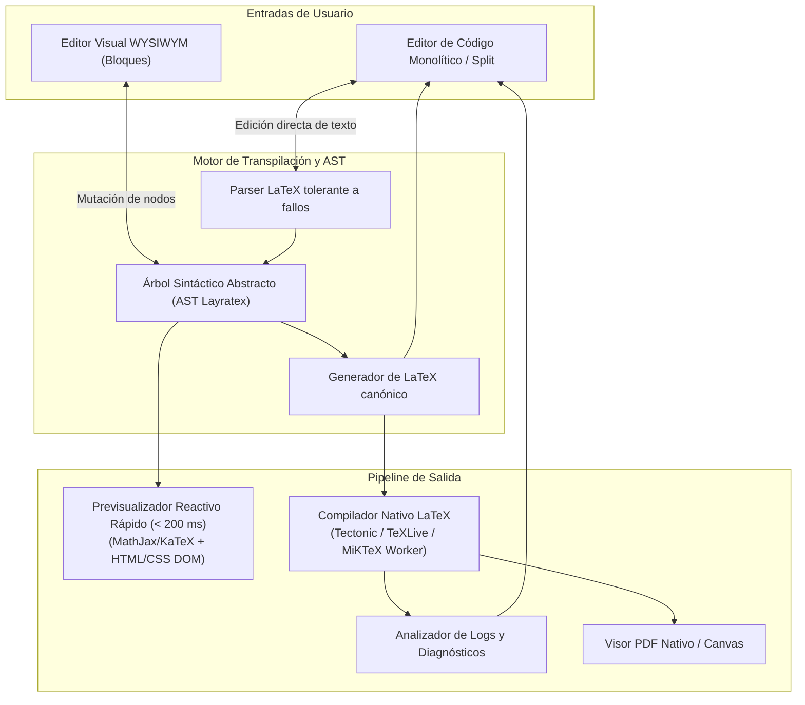

# SDD 06 — Motor de LaTeX, Pipeline y Renderizado

Este documento describe la arquitectura del motor de compilación, el parsing bidireccional entre código LaTeX y componentes visuales, y el pipeline de renderizado reactivo de **Layratex**.

---

## 6.1 Arquitectura del Pipeline de Edición Híbrida

Layratex permite que el usuario alterne libremente entre el editor de código LaTeX, el editor visual estructurado por bloques y una vista previa reactiva.

---

## 6.2 Parser Bidireccional y Preservación Round-Trip

Uno de los mayores retos en editores LaTeX visuales es no destruir el formato original, comentarios ni macros personalizadas del usuario.

### Principios del Parser Layratex:
1. **Preservación de Fidelidad:** Cada nodo del AST almacena metadatos de tokens de texto original, incluyendo espacios, saltos de línea y comentarios (`%`).
2. **Tolerancia a Sintaxis Desconocida:** Si el usuario inserta un paquete o macro compleja no reconocida por la interfaz visual, el sistema no falla; envuelve el fragmento en un bloque de código opaco (`RawLaTeXBlock`) editable directamente, garantizando compatibilidad del 100%.

---

## 6.3 Estrategia de Renderizado en 2 Niveles

Para satisfacer el requisito de latencia inferior a 200 ms (**RNF-04**), la compilación se desacopla en dos niveles:

| Nivel | Mecanismo | Latencia | Propósito |
| :--- | :--- | :--- | :--- |
| **Nivel 1: Live Preview Incremental** | Motor web/vectorial local (KaTeX para fórmulas matemáticas + transpilador de sintaxis básica LaTeX a HTML/CSS). | **< 50 - 150 ms** | Proporciona retroalimentación instantánea mientras el usuario teclea en tiempo real. |
| **Nivel 2: Full PDF Compilation** | Proceso en segundo plano desacoplado (Worker nativo invocando Tectonic o binario LaTeX instalado). | **1 - 3 s (Debounced)** | Genera el PDF final tipográficamente perfecto para exportación e impresión. |

---

## 6.4 Analizador Inteligente de Diagnósticos de Compilación

La salida estándar de los compiladores LaTeX tradicionales suele ser críptica (`Transcript/Log` de miles de líneas).

Layratex integra un `LaTeXLogParser` reactivo que:
1. Detecta patrones estándar: `! LaTeX Error: <mensaje>` y `l.<línea_número> <contexto>`.
2. Mapea la línea del archivo compilado con el nodo del AST correspondiente en la UI.
3. Coloca subrayados ondulados rojos (*squiggly lines*) directamente en el editor y ofrece botones de acción rápida (*Quick Fixes*) cuando el error es común (ej. entorno no cerrado, paquete faltante `\usepackage{...}`).
