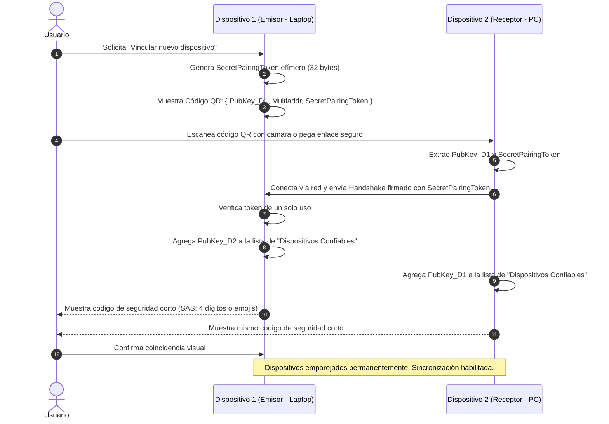

# SDD 07 — Seguridad, Identidad y Criptografía

Este documento define el modelo de seguridad criptográfica, la identidad soberana de los dispositivos y el protocolo de cifrado extremo a extremo (E2EE) de **Layratex**.

---

## 7.1 Principios de Seguridad
* **Zero-Knowledge:** Ningún servidor intermediario (STUN, TURN, señalización) tiene capacidad de descifrar datos ni metadatos de los documentos.
* **Identidad Soberana (Self-Sovereign Identity):** Sin dependencia de cuentas centralizadas con contraseña o proveedores OAuth2 externos obligatorios. La identidad es matemática.
* **Seguridad por Defecto:** Todo canal P2P está autenticado y cifrado con algoritmos modernos recomendados internacionalmente.

---

## 7.2 Primitivas Criptográficas Empleadas

| Propósito | Algoritmo Criptográfico | Justificación |
| :--- | :--- | :--- |
| **Identidad y Firmas Digitales** | **Ed25519** | Rápido, resistente a ataques de canal lateral y claves compactas (32 bytes). |
| **Intercambio de Claves Efímeras** | **X25519 (ECDH)** | Estándar de la industria para acuerdo de claves Diffie-Hellman en curva elíptica. |
| **Cifrado Autenticado Simétrico** | **ChaCha20-Poly1305** | Rendimiento excepcional en CPU sin soporte de hardware AES y seguridad de 256 bits. |
| **Funciones Hash y KDF** | **BLAKE3 / SHA-256 / Argon2id** | BLAKE3 para checksums ultrarrápidos de deltas; Argon2id para derivar claves de respaldo locales. |

---

## 7.3 Flujo de Emparejamiento Seguro de Dispositivos (QR / Pairing Code)

El usuario vincula dos de sus equipos (ej. PC Desktop y Laptop) sin escribir contraseñas complejas:

---

## 7.4 Protocolo de Cifrado en Tránsito (Noise Protocol Framework)

Para la comunicación P2P se implementa el patrón **Noise_XX**:
1. Ambos nodos intercambian claves públicas efímeras Diffie-Hellman.
2. Cada nodo transmite su clave pública estática (`Ed25519` mapeada a `X25519`) de forma ya cifrada con las claves efímeras acordadas.
3. Se verifican las firmas mutuas contra la lista de dispositivos autorizados del usuario.
4. Se establece un túnel bidireccional seguro que renueva llaves de sesión (*rekeying*) periódicamente para garantizar **Perfect Forward Secrecy (PFS)**.

---

## 7.5 Niveles de Acceso y Revocación

* **Owner (Propietario):** Los dispositivos propios del usuario comparten la clave simétrica de cifrado maestro del espacio de trabajo.
* **Colaborador de Lectura/Escritura:** Recibe la clave del documento actual y permisos para emitir operaciones CRDT firmadas.
* **Colaborador de Solo Lectura:** Recibe deltas cifrados pero sus operaciones locales no son aceptadas por los demás nodos.
* **Revocación de Dispositivo:**
  * Si un dispositivo es extraviado o revocado por el usuario, el dispositivo emisor genera una nueva clave de cifrado simétrica para el documento (*Key Rotation*), la distribuye únicamente a los dispositivos válidos restantes y marca el ID revocado en la lista de revocación local.
