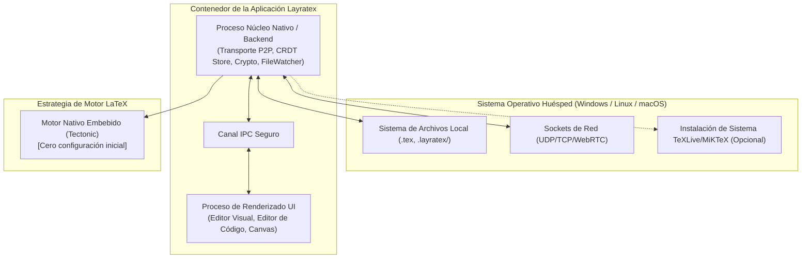

# SDD 08 — Plataforma, Empaquetado y Despliegue

Este documento define la estrategia de soporte multiplataforma, la arquitectura de empaquetado del cliente de escritorio y el manejo del entorno de ejecución de LaTeX en **Layratex**.

---

## 8.1 Soporte Multiplataforma (Windows, Linux, macOS)

En cumplimiento con el requisito **RNF-01**, el sistema operará de manera idéntica en:
* **Linux:** Distribuciones principales (Ubuntu/Debian, Fedora, Arch) vía paquetes `.AppImage`, `.deb` y `.tar.gz`.
* **Windows:** Windows 10 y Windows 11 (64-bit) vía instalador `.msi` o `.exe`.
* **macOS:** macOS Sonoma, Sequoia y posteriores (binarios universales para Apple Silicon ARM64 e Intel x86_64).

---

## 8.2 Arquitectura del Runtime de Escritorio

---

## 8.3 Gestión del Compilador LaTeX (Cero Fricción para el Usuario)

Uno de los mayores dolores de cabeza para los usuarios de LaTeX es la instalación pesada y engorrosa de gigabytes de paquetes (TeXLive/MiKTeX):

### Solución Híbrida Inteligente de Layratex:
1. **Motor Moderno Autónomo (Tectonic Engine):**
   * Layratex incluye o descarga bajo demanda el binario ligero de **Tectonic** (motor LaTeX basado en XeTeX escrito en Rust).
   * **Auto-descarga de paquetes:** Si un documento utiliza `\usepackage{amsmath}` o `\usepackage{tikz}`, Tectonic descarga automáticamente solo el paquete exacto necesario en caché local, sin obligar al usuario a instalar 5 GB de TeXLive.
2. **Detección Automática de TeXLive / MiKTeX preinstalado:**
   * Si el usuario ya posee una suite completa de LaTeX instalada en su máquina, Layratex la detecta automáticamente y permite seleccionarla en los ajustes del proyecto para máxima compatibilidad con compilaciones avanzadas (`pdflatex`, `lualatex`, `xelatex`).

---

## 8.4 Estrategia de Actualización y Telemetría Cero

* **Actualizaciones Seguras:** El cliente descargará actualizaciones firmadas criptográficamente con verificación de checksum antes de la instalación.
* **Privacidad Total (Sin Telemetría Invasiva):** No se envían datos de uso ni contenidos de documentos a ningún servidor central; cualquier reporte de errores es 100% opt-in por parte del usuario.
